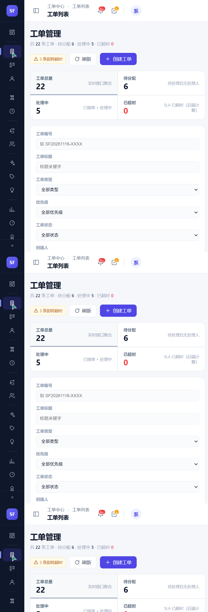
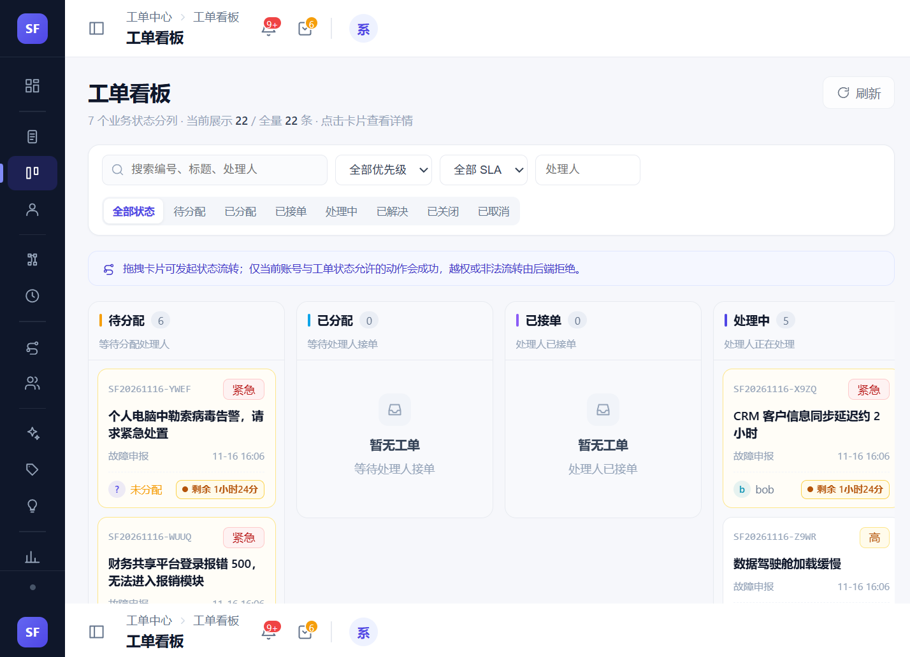
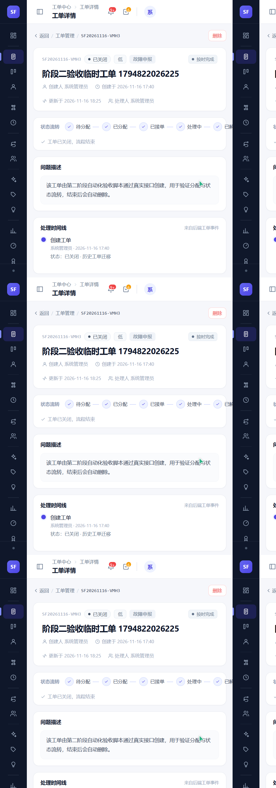
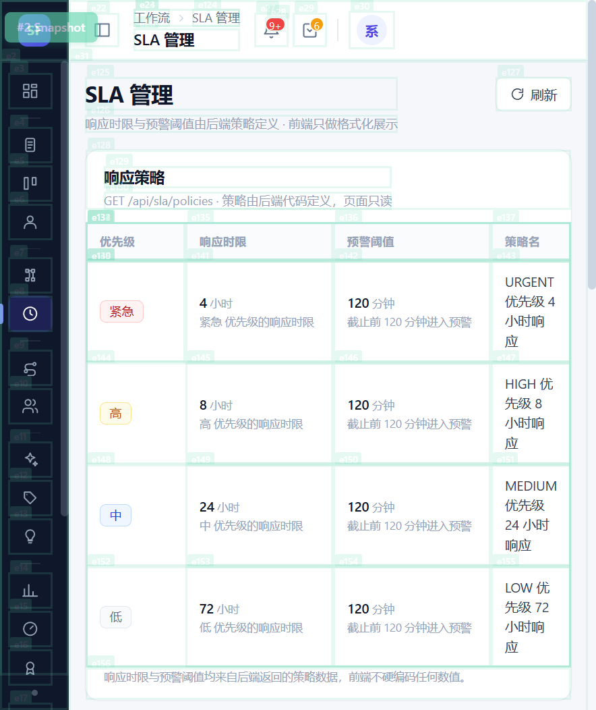
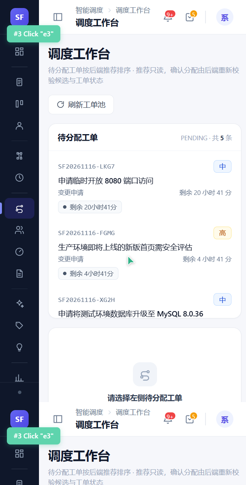
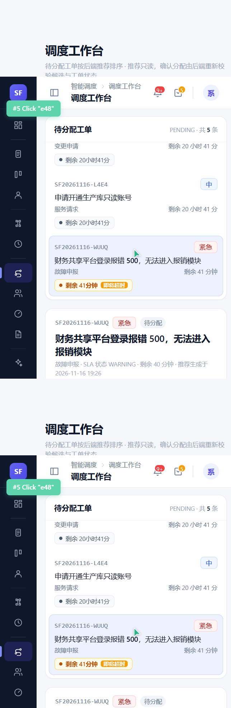
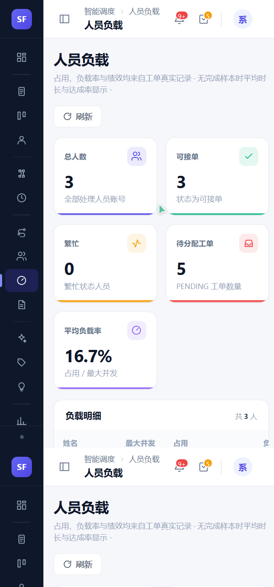

# ServiceFlow AI

AI 智能工单与服务调度平台。围绕「工单创建 → 派单/接单 → 处理 → 解决 → 关闭」的完整闭环，提供 SLA 监控、规则化智能调度、AI 分诊与处理建议、知识库沉淀和运营分析。

项目采用 **Java + AI** 的双服务结构：Java 负责业务、权限与数据一致性，Python 只负责模型调用与结构化输出，前端专注于交互与可视化。

## 1. 项目背景

服务台/运维团队日常面临三类问题：工单分派依赖人工经验、SLA 超时缺少预警、相似问题反复处理。本项目把这些环节做成可运行的工程化系统，并在关键决策点引入 AI 辅助（而不是让 AI 直接改数据），所有 AI 建议都需要人工确认后才写回业务。

## 2. 项目目标

- 业务闭环：工单全生命周期 + SLA + 调度 + AI + 知识库 + 分析报表。
- 工程规范：配置外置、统一返回与异常、请求追踪、容器化、CI、自动化测试。
- 可解释：每项技术都有真实使用场景，开发者能讲清设计与取舍（见 [面试讲解](docs/interview-guide.md)）。

## 3. 核心功能

| 模块 | 能力 |
| --- | --- |
| 数据驾驶舱 | 工单趋势、状态分布、SLA 概览、人员负载摘要 |
| 工单中心 | 创建、列表/看板、详情、编辑、事件时间线、状态流转（接单/开始/解决/关闭/取消） |
| 工作流引擎 | 合法流转校验、动作权限、流转记录 |
| SLA 管理 | 各优先级响应时限（可配置）、截止时间持久化、预警/超时/完成判定 |
| 人员管理 | 处理人、技能、可用性、实时负载 |
| 智能调度 | 技能/负载/SLA/绩效四维加权评分、Top5 推荐、确认分配、调度历史 |
| AI 智能分析 | 分诊、优先级建议、处理方案、知识推荐、调度辅助、工单问答 |
| AI 会话 | 多轮会话、消息记录、建议反馈 |
| 知识库 | 分类检索、条目维护、工单关联 |
| 数据分析 | 工单/ SLA /人员/调度/AI 效果分析、综合报表与 CSV 导出 |
| 系统能力 | JWT 鉴权与角色控制、请求 ID 追踪、慢 SQL 观测、健康检查、OpenAPI |

## 4. 技术架构

```
浏览器
  │  http://127.0.0.1:5173（开发）/ http://127.0.0.1:8085（容器）
  ▼
Vue 3 + Vite + TypeScript（前端，nginx 托管并反代 /api）
  │  /api/**
  ▼
Spring Boot 3.5（Java 17 编译目标）+ JdbcTemplate  ──HTTP──▶  FastAPI（Python 3.11）
  │        │                                                  │
  ▼        ▼                                                  ▼
MySQL 8.4  ticket_events / dispatch_logs / ai_analyses     DeepSeek API（仅 Python 持有 Key）
```

- 前端不直接访问 Python，也不持有任何密钥。
- Java 与 Python 通过 `X-Request-Id` 串联日志，便于定位一次 AI 分析的全链路。
- 部署形态见 [docker-compose.yml](docker-compose.yml)：mysql、migrate、ai、backend、frontend。

### 技术栈

| 层 | 技术 |
| --- | --- |
| 前端 | Vue 3.5、TypeScript 5.9、Vite 7、vue-router 4、ECharts 6 |
| 后端 | Java 21 运行 / 17 编译、Spring Boot 3.5.16、JdbcTemplate、HikariCP、JJWT 0.12、springdoc 2.8 |
| AI | Python 3.11、FastAPI、Uvicorn、httpx、Pydantic、DeepSeek API |
| 数据 | MySQL 8.4 |
| 工程 | Maven Wrapper、Docker Compose、GitHub Actions |

## 5. 核心业务流程

```
创建工单 ──▶ OPEN ──分配/接单──▶ ASSIGNED ──接收──▶ IN_PROGRESS
                │                                        │
                ├──取消──▶ CANCELLED                     ├──解决──▶ RESOLVED ──关闭──▶ CLOSED
                └────────────────────────────────────────┘
```

- 状态与动作的合法性由 `TicketWorkflowEngine` 集中校验，每次流转写入 `ticket_events`。
- SLA 在创建时计算 `sla_due_at` 并持久化；完成时间优先取 `resolved_at / closed_at / cancelled_at`。
- 调度推荐按配置权重打分（技能 0.40、负载 0.30、SLA 0.20、绩效 0.10），分配时用数据库条件更新避免重复分配。
- AI 分析结果入库为建议，人工采纳后才写回工单。

更完整的流程图见 [业务流程图](docs/business-flow.md)。

## 6. 数据库设计

14 张业务表，按域分为：用户认证、工单与事件、人员技能与调度、AI 分析与会话、知识库。详细字段、索引与关系见 [数据库设计](docs/database-design.md)。

## 7. 本地开发环境搭建

前置条件：JDK 17+（已在 JDK 21 验证）、Node.js 20+、Python 3.11+、MySQL 8.4；无需单独安装 Maven（使用 Wrapper）。

```powershell
# 1) 数据库（本机 MySQL 或 deploy 下的 Compose）
cd deploy
Copy-Item .env.example .env   # 填写数据库密码
docker compose up -d          # Docker 不可用时使用本机 MySQL

# 2) Python AI（8000）
cd ..\ai-python
python -m venv .venv
.\.venv\Scripts\python.exe -m pip install -r requirements.txt
.\.venv\Scripts\python.exe -m uvicorn app.main:app --host 127.0.0.1 --port 8000

# 3) Java 后端（8080）
cd ..\backend-java
$env:JAVA_HOME = "D:\JDK21"
$env:MYSQL_PASSWORD = "<数据库密码>"
$env:JWT_SECRET = "<至少 32 字节随机串>"
$env:ADMIN_INITIAL_PASSWORD = "<初始管理员密码>"
.\mvnw.cmd spring-boot:run

# 4) 前端（5173）
cd ..\frontend
node .\node_modules\vite\bin\vite.js    # 若依赖未安装：npm.cmd install
```

默认管理员账号为 `admin`，密码取启动时的 `ADMIN_INITIAL_PASSWORD`（仅当用户表为空时创建）。

## 8. Docker 部署

```bash
cp deploy/.env.example .env      # 填写 MYSQL_PASSWORD / JWT_SECRET / DEEPSEEK_API_KEY 等
docker compose --env-file .env up -d --build
docker compose ps                # 等待 mysql/ai/backend/frontend 为 healthy
```

访问 `http://127.0.0.1:8085`。数据持久化在 `mysql-data` 卷，`docker compose down` 不会删除数据；日志在 `backend-logs` 卷。

完整说明（启动顺序、健康检查、迁移、备份、故障排查）见 [部署文档](docs/phase7-deployment.md) 与 [部署指南](docs/deployment-guide.md)。

> 当前开发机未安装 Docker，容器构建与启动尚未实测；所有步骤均为可复现命令，未宣称部署成功。

## 9. 环境变量

所有敏感配置均由环境变量注入，仓库中只有占位符示例（[.env.example](.env.example)、[deploy/.env.example](deploy/.env.example)）。

| 变量 | 说明 |
| --- | --- |
| `MYSQL_HOST/PORT/DATABASE/USER/PASSWORD` | 数据库连接，密码无默认值 |
| `JWT_SECRET` / `JWT_EXPIRE_MINUTES` | JWT 密钥（≥32 字节，缺失拒绝启动）与有效期 |
| `ADMIN_INITIAL_PASSWORD` | 初始管理员密码 |
| `SPRING_PROFILES_ACTIVE` | `dev`（默认）/ `test` / `prod` |
| `SLA_WARNING_MINUTES`、`SLA_*_HOURS` | SLA 预警阈值与各优先级时限 |
| `CORS_ALLOWED_ORIGINS` | 跨域白名单，默认空（同源部署不需要） |
| `AI_SERVICE_BASE_URL`、`AI_SERVICE_*_TIMEOUT_MS` | Python 服务地址与超时 |
| `DEEPSEEK_API_KEY` 等 | 只注入 Python 服务 |

## 10. 测试方式

```powershell
# Java：编译 + 172 个单元测试 + 打包
cd backend-java
.\mvnw.cmd -B clean package

# Python：33 个测试（模型调用全部 Mock，不消耗额度）
cd ai-python
.\.venv\Scripts\python.exe -m pytest -q

# 前端：类型检查 + 生产构建
cd frontend
node .\node_modules\vue-tsc\bin\vue-tsc.js --noEmit
node .\node_modules\vite\bin\vite.js build
```

CI 配置见 [.github/workflows/ci.yml](.github/workflows/ci.yml)，说明见 [CI 文档](docs/phase7-ci.md)。

## 11. 接口文档

- Swagger UI：`http://127.0.0.1:8080/swagger-ui/index.html`
- OpenAPI JSON：`http://127.0.0.1:8080/v3/api-docs`
- Python：`http://127.0.0.1:8000/docs`
- 接口索引、错误码、权限与分页规范：[接口文档](docs/phase7-api-documentation.md)

## 12. 页面截图

工单与工作流（第三阶段真实截图）：






智能调度（第四阶段真实截图）：





> 第五至第七阶段新增 AI 工作空间、知识库、分析与监控页面，UI 截图可在登录后按 [演示指南](docs/demo-guide.md) 的步骤自行截取。

## 13. 项目目录

```
serviceflow-ai/
├── frontend/                  # Vue 3 前端（视图、组件、API 封装、路由）
├── backend-java/              # Spring Boot 后端（auth/ticket/dispatch/intelligence/knowledge/analytics/health/common）
├── ai-python/                 # FastAPI AI 服务（prompts、schemas、llm、限流）
├── deploy/                    # MySQL Compose、初始化 SQL、迁移脚本、env 示例
├── docs/                      # 审计、方案、部署、安全、可观测性、性能、接口、CI、演示与阶段记录
├── .github/workflows/ci.yml   # CI
├── docker-compose.yml         # 全栈编排
├── .env.example               # 环境变量占位符
└── README.md
```

## 14. 常见问题

| 问题 | 处理 |
| --- | --- |
| `/api/health/ready` 返回 503 | 数据库不可用或密码错误；看 `checks` 中 `mysql` 的 message |
| 返回 `DEGRADED` | MySQL 正常、Python AI 不可用；核心业务可用，检查 ai 容器或 8000 端口 |
| 后端启动即退出 | `JWT_SECRET` 缺失或不足 32 字节（fail-fast 保护） |
| 前端 401 | Token 过期或用户被禁用；重新登录 |
| 管理端看不到 AI 结果 | 未配置 `DEEPSEEK_API_KEY` 或未启动 Python 服务；错误码见响应头 `X-AI-Error-Code` |
| 端口冲突 | 前端 5173、后端 8080、Python 8000、MySQL 3306；用 `SERVER_PORT` 等环境变量调整 |
| npm 报 `npm-prefix.js` 缺失 | 使用 `npm.cmd` 或直接 `node .\node_modules\vite\bin\vite.js` |

## 15. 交付文档索引

| 文档 | 内容 |
| --- | --- |
| [架构说明](docs/architecture.md) | 分层、边界、数据流、技术选型 |
| [业务流程](docs/business-flow.md) | 状态机、SLA、调度、AI 确认流程 |
| [数据库设计](docs/database-design.md) | 表、索引、关系、迁移 |
| [部署指南](docs/deployment-guide.md) | 从零启动与运维 |
| [面试讲解](docs/interview-guide.md) | 11 个设计问题的真实回答 |
| [演示指南](docs/demo-guide.md) | 12 步可复现演示脚本 |
| [审计报告](docs/phase7-audit.md) | 工程化前的问题清单 |
| [改造方案](docs/phase7-refactor-plan.md) | 实施顺序与验收标准 |
| [安全加固](docs/phase7-security.md) | 配置分层与安全检查 |
| [可观测性](docs/phase7-observability.md) | 日志规范与健康检查 |
| [性能优化](docs/phase7-performance.md) | 前后端优化与实测对比 |
| [接口文档](docs/phase7-api-documentation.md) | OpenAPI 地址与接口索引 |
| [CI](docs/phase7-ci.md) | 工作流与本地复现 |
| [测试报告](docs/phase7-test-report.md) | 已通过/未通过/未测试 |
