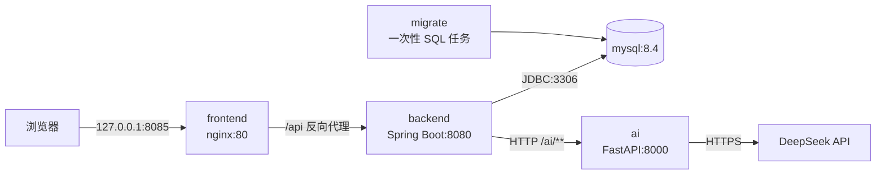

# ServiceFlow AI 系统架构说明

> 本文基于当前仓库真实代码与配置整理，覆盖后端、前端、AI 服务与部署编排。
> 未在本机启动验证的内容标注「未验证」；未实现的规划不写入本文。
> 版本基线：`backend-java/pom.xml` 声明 Spring Boot 3.5.16、`java.version=17`（以 pom 为准，非 21）。

## 1. 项目定位

ServiceFlow AI 是一套面向 IT 服务台的工单处理系统，覆盖工单受理、流转、SLA 计时、规则调度、AI 辅助分析与知识库检索。系统由三个可独立构建的应用和一个数据库组成：

| 组成 | 目录 | 角色 |
| --- | --- | --- |
| Java 后端 | `backend-java/` | 唯一业务入口：鉴权、工单、调度、分析、知识、报表 |
| Vue 前端 | `frontend/` | 只调用 Java 的 `/api/**`，不直连数据库与 Python |
| Python AI | `ai-python/` | 只做模型调用与结构化输出，不写业务库 |
| MySQL 8.4 | `deploy/init/`、`deploy/migrations/` | 业务数据与 AI 结果的唯一持久化存储 |

## 2. 架构选型：为什么是模块化单体

| 真实原因 | 在代码中的体现 |
| --- | --- |
| 单人项目，协作与拆分成本高于收益 | 单一 Maven 工程、单一 Spring Boot 进程，按包分域而非独立服务 |
| 事务边界清晰 | `TicketWorkflowService`、`DispatchService`、`AiSuggestionService` 均用 `@Transactional` 在本地事务内写完状态与事件 |
| 部署简单 | 根目录 `docker-compose.yml` 一次编排 MySQL、迁移、AI、后端、前端 |
| AI 是唯一外部依赖 | Java 仅通过 `AiServiceClient` 调用 Python；Python 再调用 DeepSeek，业务写入始终在 Java |

若拆成微服务，工单状态、事件、SLA、调度日志会跨服务分布，当前规模下会引入分布式事务、服务发现和额外运维，收益不足。

## 3. 三端职责边界

| 边界 | 允许 | 禁止 / 现状 |
| --- | --- | --- |
| 前端 → Java | 所有业务操作走 `frontend/src/api/request.ts` 的 `request()`，自动带 `Authorization: Bearer` | 不直连 MySQL；不直连 Python；不硬编码后端域名（`VITE_API_BASE_URL` 可覆盖） |
| Java → MySQL | `JdbcTemplate` + 预编译占位符，事务在 service 层 | 控制器不直接访问 Repository；不拼接用户输入到 SQL |
| Java → Python | `AiServiceClient` 用 `RestClient` 调 `/ai/**`，请求体为 `{requestId, payload}` | Java 不持有 DeepSeek Key；不把模型结果直接写入工单 |
| Python → Java | 无回调、无数据库连接 | Python 只返回结构化 `result`，由 Java 校验、落库、人工确认 |

Python 服务的 6 个接口在 `ai-python/app/main.py`：`/ai/ticket-analysis`、`/ai/priority-recommendation`、`/ai/solution-generation`、`/ai/knowledge-recommendation`、`/ai/dispatch-assistance`、`/ai/ticket-qa`。
其中 Java 当前只调用前三个、调度与追问共 5 个路径（见 `AiAnalysisService.pathOf`）；`/ai/knowledge-recommendation` 已实现但 Java 未调用，知识推荐由 Java 关键词检索完成。

## 4. 后端分层与包结构

包根为 `com.serviceflow.ai`，共 178 个 Java 文件、17 个 Controller。

| 包 | 实际子包 | 职责 |
| --- | --- | --- |
| `auth` | `context` `controller` `dto` `entity` `enums` `interceptor` `jwt` `repository` `service` | 登录、JWT、用户查询、当前用户上下文 |
| `ticket` | `controller` `dto` `entity` `enums` `repository` `service` `workflow` | 工单 CRUD、状态机、SLA、事件 |
| `dispatch` | `config` `controller` `dto` `entity` `enums` `repository` `service` `strategy` `vo` | 人员、技能、负载、四维评分与调度日志 |
| `intelligence` | `client` `config` `context` `controller` `dto` `entity` `enums` `repository` `service` `vo` | AI 调用、分析记录、会话、建议确认 |
| `knowledge` | `controller` `dto` `entity` `repository` `service` `vo` | 知识文章、关键词检索、工单关联 |
| `analytics` | `controller` `dto` `repository` `service` | 工单/SLA/人员/调度/AI 聚合与报表 |
| `health` | `controller` `dto` `service` | 存活与就绪检查（含真实 SQL） |
| `common` | `config` `dto` `exception` `observability` `web` | 统一响应、异常、请求追踪、CORS、OpenAPI |

层次职责：

| 层 | 真实职责 | 代表类 |
| --- | --- | --- |
| `controller` | 参数绑定、`@Valid` 校验、响应组装 | `TicketController`、`AiAnalysisController` |
| `service` | 权限、事务、编排、业务规则 | `TicketWorkflowService`、`DispatchService`、`AiAnalysisService` |
| `repository` | 参数化 SQL、行映射、条件更新 | `TicketRepository`、`AnalyticsRepository` |
| `dto` | 入参校验与出参结构（record） | `TicketCreateRequest`、`TicketSlaResponse` |
| `entity` | 数据库行对象（可变 POJO） | `Ticket`、`AiSuggestion`、`KbArticle` |
| `enums` | 状态、动作、优先级、分析类型等封闭取值 | `TicketStatus`、`TicketAction`、`SlaState` |
| `config` | 外部化配置绑定与技术配置 | `DispatchProperties`、`AiProperties`、`WebMvcConfig` |

17 个 Controller 的分布：

| 包 | Controller |
| --- | --- |
| `analytics` | `AnalyticsController`、`AgentAnalyticsController`、`DispatchAnalyticsController`、`AiAnalyticsController`、`ReportController` |
| `auth` | `AuthController`、`UserController` |
| `ticket` | `TicketController`、`SlaController` |
| `dispatch` | `DispatchController`、`AgentController`、`SkillController` |
| `intelligence` | `AiAnalysisController`、`AiSessionController`、`AiTicketContextController` |
| `knowledge` | `KnowledgeController` |
| `health` | `HealthController` |

## 5. 鉴权链路

1. `WebMvcConfig.addInterceptors` 将 `AuthInterceptor` 挂到 `/api/**`，仅排除 `/api/auth/login` 与 `/api/health/**`。
2. `AuthInterceptor.preHandle`：
   - `OPTIONS` 直接放行（CORS 预检不带凭据）；
   - 校验 `Authorization: Bearer <token>`，`JwtService.parse` 验证签名与过期；
   - 用 JWT `subject` 中的 userId **每请求查库**，用户不存在或被禁用（`status != 1`）返回 401；
   - 角色以数据库最新 `role` 为准，写入 `UserContext`（ThreadLocal）与 MDC 的 `user`。
3. `AuthInterceptor.afterCompletion` 无条件 `UserContext.remove()`，避免 Tomcat 线程复用导致串号。
4. 服务层二次校验：
   - `TicketWorkflowEngine.can/assertAllowed` 校验状态与创建人/处理人；
   - `AnalyticsSecurity.requireViewer` 仅允许 `ADMIN`、`AGENT`；
   - `DispatchSecurity.requireAdmin` 或 `requireAdminOrAgent`；
   - `AiTicketAccessGuard`：`ADMIN` 全量，`USER` 仅本人创建，`AGENT` 仅本人创建或分配给本人。

## 6. 一次请求的完整数据流

以「管理员确认调度分配」为例：

1. 浏览器 → nginx（生产）或 Vite 代理（开发）→ `POST /api/dispatch/assign`；nginx 写入 `X-Request-Id $request_id`。
2. `RequestIdFilter`（`@Order(HIGHEST_PRECEDENCE)`）读取 `X-Request-Id`，仅接受 `^[A-Za-z0-9._-]{8,64}$`，否则生成 UUID；写入 MDC `requestId` 与响应头。
3. `AuthInterceptor` 完成 JWT 与用户校验，MDC 增加 `user`，建立 `UserContext`。
4. `DispatchController` 绑定 `DispatchAssignRequest`；`DispatchService.assign` 先 `requireAdmin`，再重新计算候选。
5. 候选命中后调用 `TicketWorkflowService.assign`；`TicketWorkflowService.transition` 经 `TicketWorkflowEngine.assertAllowed` 校验，执行 `TicketRepository.updateWorkflowState`（`WHERE id=? AND status=?`）。
6. 同一事务内写 `ticket_events`；随后 `DispatchService` 写 `dispatch_logs`（含候选快照 JSON）。
7. 返回 `ApiResponse<DispatchAssignResponse>`；`RequestIdFilter` 在 `finally` 输出访问日志并清理 MDC。
8. 若链路进入 AI：`AiAnalysisService` 先落 `ai_analyses` 的 `PENDING` 记录，再通过 `AiServiceClient` 调 Python；客户端从 MDC 取 `requestId` 作为 `X-Request-Id` 透传，Python 日志用同一 ID，便于跨服务排查。

日志格式由 `application.yml` 的 `logging.pattern` 固定为「时间 级别 [requestId] [user] logger - 消息」，不记录请求体、Token、密码与 Prompt 正文。

## 7. 关键设计决策与替代方案

| 决策 | 真实实现 | 替代方案与不采用原因 |
| --- | --- | --- |
| 持久层 | `spring-boot-starter-jdbc` + `JdbcTemplate`，SQL 显式、全部 `?` 占位符 | JPA 对多表聚合与条件更新不直观；MyBatis 需额外 XML/注解映射。当前分析与条件更新 SQL 较多，手写更可控 |
| 认证 | `jjwt 0.12.6` 自签 JWT + `spring-security-crypto` 仅用 BCrypt | 不引入完整 Spring Security，避免默认过滤链与配置复杂度；角色仅 `ADMIN/AGENT/USER`，拦截器足够 |
| 限流 | Java `AiRequestLimiter` 用 `ConcurrentHashMap<Long, Deque<Long>>`；Python `RateLimiter` 用进程内 `deque` | 未引入 Redis。限流只在单实例内准确，多副本会各自计数（当前部署为单 backend、单 ai 容器） |
| AI 调用 | `RestClient` 同步调用，URL 路径与超时可配 | 未引入消息队列。分析结果需即时返回给页面，异步化会增加任务状态与补偿复杂度 |
| 知识检索 | MySQL `LIKE` + 命中数排序，中文补充二元组 | 未使用向量库/向量检索，当前数据量与可解释性优先 |
| 部署 | 根 `docker-compose.yml` 五服务编排，前端 nginx 同源反代 | 未拆微服务、未上 Kubernetes；单机 Compose 足够当前规模 |

## 8. 数据库与部署形态

当前初始化脚本共 14 张业务表：

| 分类 | 表 |
| --- | --- |
| 账号与工单 | `users`、`tickets`、`ticket_events` |
| 调度 | `agent_profiles`、`agent_skills`、`agent_skill_relations`、`ticket_type_skill_rules`、`dispatch_logs` |
| AI | `ai_sessions`、`ai_analyses`、`ai_messages`、`ai_suggestions` |
| 知识 | `kb_articles`、`kb_ticket_links` |

部署拓扑（与根 `docker-compose.yml` 的 5 个服务一致）：

| 服务 | 镜像/构建 | 关键点 |
| --- | --- | --- |
| `mysql` | `mysql:8.4` | 挂载 `deploy/init` 首次初始化；仅容器网络内暴露 3306 |
| `migrate` | `mysql:8.4` | `depends_on` 数据库健康后执行 phase5/phase6 迁移，`restart: no` |
| `ai` | `./ai-python` | 只注入 `DEEPSEEK_API_KEY` 等模型配置；健康检查 `/health` |
| `backend` | `./backend-java` | 依赖 mysql 健康、migrate 成功、ai 健康；就绪检查 `/api/health/ready` |
| `frontend` | `./frontend` | 唯一宿主机端口映射 `127.0.0.1:${FRONTEND_PORT:-8085}:80`；健康检查 `/healthz` |

配置分层：`application.yml` 提供公共项与环境变量默认值；`application-dev.yml` 降低日志级别；`application-prod.yml` 提高日志门槛；`application-test.yml` 供测试。敏感值只来自环境变量，仓库不跟踪 `.env`。

## 9. 可观测性与健康检查

| 能力 | 实现 |
| --- | --- |
| 请求追踪 | `RequestIdFilter`：`X-Request-Id` 透传/生成、MDC、访问日志、响应头 |
| 跨服务追踪 | `AiServiceClient` 将 MDC `requestId` 写入 `X-Request-Id`；Python `trace_id` 依赖读取 |
| 慢 SQL | `common/observability` 中的 AOP 计时，阈值 `slow-sql.threshold-ms`（默认 500ms），只记 SQL 不记参数 |
| 健康检查 | `/api/health/**` 免鉴权；`/api/health/ready` 执行真实 SQL；Python `/health` 与 `/health/ready` 校验 Key 与 Prompt 文件 |
| 业务日志 | AI 调用只记录路径、耗时、状态、错误码；不记录 Key、Prompt、工单正文 |

## 10. 已知边界与当前限制

- **单实例假设**：Java 与 Python 限流均为进程内计数；多副本部署时实际额度会放大（已由代码确认，未做多副本实测「未验证」）。
- **同步 AI 依赖**：AI 超时/不可用会直接影响本次分析请求；失败只落 `FAILED` 记录，不生成伪造结果，页面需用户重试。
- **无缓存/无队列/无 Redis**：分析去重靠数据库 `findRecentSuccess` 60 秒窗口，非分布式锁。
- **知识检索是 `LIKE` 匹配**：无向量语义检索；中文靠分词与二元组提升召回，长文本相关度有限。
- **无完整 Spring Security**：没有方法级安全注解与统一安全过滤链，权限分散在拦截器与各 service 的显式校验中。
- **分析 SQL 随数据量增长可能变慢**：`AnalyticsRepository` 多为区间聚合，`phase6` 已补索引，但大数据量下的执行计划「未验证」。
- **前端路由只校验 token 是否存在**：`frontend/src/router/index.ts` 的 `beforeEach` 仅判断 `getToken()`，角色差异由后端接口与页面数据控制。
- **迁移服务一次性**：`migrate` 只执行 phase5/phase6；新建库由 `deploy/init` 覆盖 phase1–4，重复执行依赖脚本的 `IF NOT EXISTS`/`INSERT IGNORE`。
