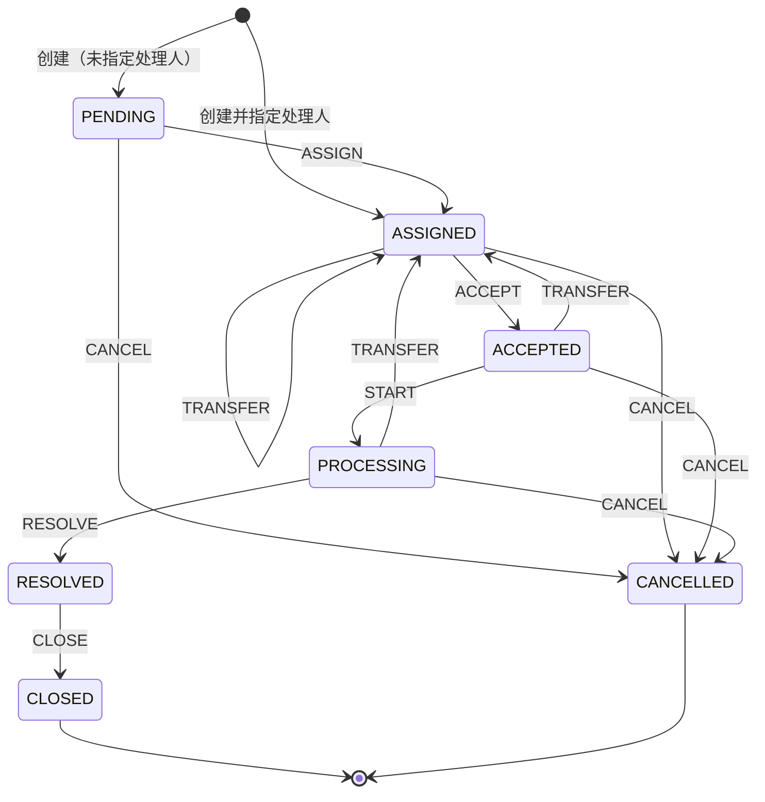

# ServiceFlow AI 业务流程说明

> 本文描述当前代码真实执行流程，涉及状态、权限、SLA、调度、AI 与统计口径。
> 未经运行验证的推论标注「未验证」；未实现的流程不写入。

## 1. 工单生命周期状态机

状态定义在 `TicketStatus`（7 个），动作定义在 `TicketAction`（7 个）。状态只能通过工作流动作变更，`PUT /api/tickets/{id}` 显式拒绝提交 `status` 或 `assignee`。

合法流转与权限（来源 `TicketWorkflowEngine.targetStatus` / `can`）：

| 动作 | 允许的起始状态 | 目标状态 | 非管理员所需身份 |
| --- | --- | --- | --- |
| `ASSIGN` | `PENDING` | `ASSIGNED` | 创建人 |
| `TRANSFER` | `ASSIGNED`、`ACCEPTED`、`PROCESSING` | `ASSIGNED` | 当前处理人 |
| `ACCEPT` | `ASSIGNED` | `ACCEPTED` | 当前处理人 |
| `START` | `ACCEPTED` | `PROCESSING` | 当前处理人 |
| `RESOLVE` | `PROCESSING` | `RESOLVED` | 当前处理人 |
| `CLOSE` | `RESOLVED` | `CLOSED` | 创建人 |
| `CANCEL` | `PENDING`、`ASSIGNED`、`ACCEPTED`、`PROCESSING` | `CANCELLED` | 创建人 |

管理员（`ADMIN`）只要状态允许即可执行任意动作；`CLOSED`、`CANCELLED` 为终态（`TicketStatus.terminal()`），不再允许流转与内容编辑。

典型非法流转（`assertAllowed` 抛出 403，或条件更新 409）：

| 尝试 | 结果 |
| --- | --- |
| `PENDING → ACCEPT / START / RESOLVE / CLOSE` | 拒绝：动作与起始状态不匹配 |
| `ASSIGNED → START / RESOLVE / CLOSE` | 拒绝：必须先 `ACCEPT` |
| `ACCEPTED → ACCEPT / RESOLVE` | 拒绝：必须先 `START` |
| `PROCESSING → CLOSE` | 拒绝：必须先 `RESOLVE` |
| `RESOLVED → CANCEL` | 拒绝：取消仅限活动态 |
| `CLOSED / CANCELLED → 任意动作` | 拒绝：终态 |
| 非创建人执行 `ASSIGN / CLOSE / CANCEL` | 拒绝：身份不符 |
| 非处理人执行 `TRANSFER / ACCEPT / START / RESOLVE` | 拒绝：身份不符 |
| 两个人同时流转同一工单 | 后提交者条件更新影响 0 行，返回 409「工单状态已变更」 |

## 2. 创建 → 分配/接单 → 开始 → 解决 → 关闭/取消

实现入口：`TicketController` → `TicketWorkflowService` / `TicketService` → `TicketWorkflowEngine` → `TicketRepository`。

| 环节 | 真实规则与副作用 |
| --- | --- |
| 创建 | 任意登录用户可创建；工单号 `SFyyyyMMdd-XXXX`（4 位安全随机字符，唯一索引兜底，最多重试 5 次）；优先级缺省 `MEDIUM`；`sla_due_at = created_at + 优先级时限`；可选 `assignee` 必须是有效处理人员，指定则直接 `ASSIGNED`，否则 `PENDING`；写 `CREATE` 事件 |
| 编辑 | 仅管理员、创建人、当前处理人，且非终态；提交 `status/assignee` 直接报错；修改优先级会按 `created_at` 重算 `sla_due_at`；有变化时写 `UPDATE` 事件 |
| 删除 | 仅 `ADMIN`；先删 `ticket_events` 再删 `tickets` |
| 分配 `ASSIGN` | `TicketWorkflowService.assign` 校验处理人有效，写入 `assignee`/`assignee_id`，写 `ASSIGN` 事件；仅 `PENDING` 可分配 |
| 转交 `TRANSFER` | 允许已分配/已接单/处理中，目标状态回到 `ASSIGNED`，需新的有效处理人，写 `TRANSFER` 事件 |
| 接单 `ACCEPT` | 仅当前处理人；首次接单写入 `first_response_at`（已存在则不覆盖），写 `ACCEPT` 事件 |
| 开始 `START` | 仅当前处理人；不新增时间戳，写 `START` 事件 |
| 解决 `RESOLVE` | 仅当前处理人；写 `resolved_at` 与 `resolution`，事件说明取解决说明或默认文案 |
| 关闭 `CLOSE` | 仅创建人/管理员；写 `closed_at`，事件说明取备注或默认文案 |
| 取消 `CANCEL` | 仅创建人/管理员；写 `cancelled_at` 与 `cancel_reason`，仅限活动态 |

所有流转在同一事务内：`WHERE id=? AND status=<期望旧值>` 条件更新 → 影响行数为 0 抛 `ConflictException`（409）→ 成功才写 `ticket_events`。
接口返回的 `allowedActions` 与 `canEdit` 由服务端 `TicketService.toResponse` 计算，前端隐藏按钮只是体验优化。

## 3. SLA 计算流程

实现：`TicketSlaService`；截止时间持久化在 `tickets.sla_due_at`，前端不自行推算。

| 步骤 | 规则 |
| --- | --- |
| 定截止时间 | 创建时 `created_at + hours(priority)`；修改优先级时按原 `created_at` 重算；创建后不再随接单/开始变化 |
| 时限策略 | `sla.policy.urgent-hours=4`、`high-hours=8`、`medium-hours=24`、`low-hours=72`；未知优先级回退 `MEDIUM` |
| 完成时间取值 | 优先级 `resolved_at` → `closed_at` → `cancelled_at`；用于「按时完成/超时完成」追溯 |
| 剩余时间 | `ceil((完成时间或当前时间) - dueAt)` 分钟，向上取整 |
| 进度百分比 | `elapsed / (dueAt - createdAt)`，四舍五入并夹紧到 0–100；总时长 ≤0 时返回 100 |
| 状态判定 | 已解决/已关闭/已取消 → `COMPLETED`；剩余 <0 → `OVERDUE`；剩余 ≤ `sla.warning-minutes`（默认 120）→ `WARNING`；否则 `ON_TRACK` |
| 配置项 | `sla.warning-minutes`、`sla.policy.*-hours`，均可由同名大写环境变量覆盖 |
| 统计差异 | `TicketSlaService` 对完成态统一返回 `COMPLETED`，不区分是否超时；超时完成由 `AnalyticsRepository` 单独统计 |

## 4. 智能调度流程

实现：`DispatchService`（编排）→ `DispatchScoringService`（加权）→ `strategy` 下 4 个策略。

### 4.1 候选过滤

1. 仅 `PENDING` 工单参与初始推荐；`recommend` 与 `assign` 都要求管理员。
2. 按工单 `type` 读 `ticket_type_skill_rules`，拆成必需技能与加分技能。
3. 候选来自 `agentService.listAgentUsers()`（`AGENT` 角色用户），每人取 `agent_profiles` 或默认档案。
4. 排除原因：账号禁用、有效状态非 `AVAILABLE`、缺少任一必需技能、占用数 ≥ `max_concurrent`。
5. 占用口径：`ASSIGNED + ACCEPTED + PROCESSING` 的工单数；负载率 `occupied / maxConcurrent × 100%`。

### 4.2 四维打分

| 维度 | 公式（`strategy/`） | 说明 |
| --- | --- | --- |
| 技能 `skill` | 无规则 70；仅有必需技能取平均；含加分项时 `0.7×必需均分 + 0.3×已命中加分均分` | 熟练度 1/2/3/4 → 60/75/90/100 |
| 负载 `workload` | `100 × (1 - occupied / maxConcurrent)` | 负载越低分越高 |
| SLA `sla` | 超时 100；预警 `70 + 30×(1 - 剩余/预警窗口)`；正常 `0–70`；完成态 0 | 与 `TicketSlaService` 共用预警窗口 |
| 绩效 `performance` | 样本 <5 用中性分 60；否则 `0.4×完成量分 + 0.4×SLA 达成率 + 0.2×速度分` | 完成量分 `min(100, 完成数×100/10)`；速度分 `100×(1 - 平均处理/平均SLA)` |

总分 = 四维分 × 归一化权重（默认 `skill 0.40`、`workload 0.30`、`sla 0.20`、`performance 0.10`），权重和不为 1 时按比例归一化。
排序：总分降序 → 负载率升序 → `agentId` 升序；默认取 Top 5（请求可指定 1–20，确认分配时内部按全量重算）。

### 4.3 确认分配与并发保护

1. `assign` 重新执行候选过滤，不信任前端回传的旧推荐。
2. 目标人员不在当前候选 → 400，并拼接真实排除原因（禁用/离线/缺技能/满载）。
3. 人员必须仍为有效处理人员，然后调用 `TicketWorkflowService.assign`，走状态机权限与 `PENDING` 条件更新。
4. 工单状态已被他人改变 → 条件更新 0 行 → 409。
5. 写入 `dispatch_logs`：`RECOMMEND` 记录推荐快照，`ASSIGN` 记录选中人员、分数、备注与完整候选 JSON。
6. 限制：人员容量是**读取时检查**，没有人员维度的数据库约束或锁；同一人员并发确认不同工单时可能超过 `max_concurrent`（代码可确认，压测「未验证」）。

## 5. AI 分析与人工确认流程

实现：`AiAnalysisController` → `AiAnalysisService` → `AiServiceClient` → Python `AnalysisService`；建议确认由 `AiSuggestionService` 完成。

### 5.1 发起与执行

1. 校验分析类型（`CHAT` 只能走会话消息接口），`DISPATCH` 需管理员；`AiTicketAccessGuard` 校验工单可见性。
2. Java 限流：`AiRequestLimiter` 每用户每分钟最多 `ai.service.user-rate-limit-per-minute`（默认 10）。
3. 去重：同用户 + 同工单 + 同类型在 `ai.service.dedupe-seconds`（默认 60 秒）内已成功，直接返回旧结果；`forceRefresh` 可跳过。
4. 组装 payload：工单字段截断、SLA 评估、技能字典；分析/方案附带知识候选 5 条；调度附带规则推荐 Top 5。
5. 先插入 `ai_analyses` 的 `PENDING` 记录，再调用 Python；失败也保留记录。
6. Python：`sanitize_ticket` 校验标题/描述非空并逐字段截断 → 加载 `prompts/<type>/v1.md` → DeepSeek JSON 模式调用（最多 3 次，指数退避）→ JSON 解析 → Pydantic 严格 Schema（`extra="forbid"`）→ 业务校验。
7. Python 业务校验：优先级建议的响应小时必须为 4/8/24/72 且与优先级一致；知识推荐只能引用候选内 `articleId`；调度推荐只能引用规则候选内 `agentId` 且不重复。
8. 成功：Java 写 `prompt_version`、`model`、`latency_ms`、`result_json`，状态 `SUCCESS`；失败：写 `error_code`/`error_message`，状态 `FAILED`，**不生成结果**。

AI 调用异常映射（`AiServiceClient`）：

| 场景 | 错误码 | HTTP |
| --- | --- | --- |
| 配置禁用 | `AI_DISABLED` | 503 |
| 连接失败/不可用 | `AI_UNAVAILABLE` | 503 |
| 读超时 | `AI_TIMEOUT` | 504 |
| 上游限流 | `AI_RATE_LIMITED` | 429 |
| 返回结构/字段不合法 | `AI_INVALID_OUTPUT` | 422 |
| 其他内部异常 | `AI_INTERNAL_ERROR` | 500 |

### 5.2 建议采纳/驳回与写回

| 步骤 | 真实行为 |
| --- | --- |
| 生成建议 | `TICKET_ANALYSIS → CLASSIFICATION`、`PRIORITY → PRIORITY`、`SOLUTION → SOLUTION`；写 `ai_suggestions`，状态 `PENDING` |
| 权限 | 分类/优先级会改工单，必须通过 `TicketWorkflowEngine.canEdit`（管理员/创建人/处理人，非终态） |
| 原子占用 | `UPDATE ... SET status='ACCEPTED' WHERE id=? AND status='PENDING'`，0 行则 409，保证并发/重复提交只成功一次 |
| 分类写回 | 调用 `TicketService.update` 更新 `type`，走正常编辑校验并写 `UPDATE` 事件 |
| 优先级写回 | 调用 `TicketService.update` 更新 `priority`，SLA 按 `created_at` 重算 |
| 方案采纳 | 只记录人工采纳说明，不改工单字段 |
| 执行结果 | 分类/优先级成功后状态 `EXECUTED`；方案采纳后状态 `ACCEPTED` |
| 写回失败 | 捕获运行时异常，`revertToPending` 释放占用，允许修正后重试 |
| 驳回 | `UPDATE ... SET status='REJECTED' WHERE id=? AND status='PENDING'`，0 行返回 409 |

AI 全程不自动修改工单；模型结果只是 `PENDING` 建议，必须人工确认。

## 6. 知识库关联与检索流程

实现：`KnowledgeService` + `KbArticleRepository` + `KbTicketLinkRepository`。

1. 关键词构建：AI 关键词（若有）+ 标题分词；不足 4 个时补充描述前 40 字；去重后最多 8 个。
2. 分词：按空白、中英文标点切分；长度 2–20 的片段入词；含中文时补充最多 4 个二元组，提升 `LIKE` 召回。
3. 检索：`searchByKeywords` 只查 `status='PUBLISHED'`，按 `title/problem/keywords` 的命中次数排序，同分按更新时间倒序。
4. 相关度：`min(99, 50 + 命中数×8)`，并返回命中的关键词作为可解释理由。
5. 传给 AI 的候选只含 `articleId/title/category/keywords/problemSummary`，最多 5 条。
6. 工单关联：管理员或处理人员可关联；工单必须可见；唯一键 `(article_id, ticket_id)` 防重复，重复返回 409；解除关联仅管理员。
7. AI 分析成功且结果含 `keywords` 时，`AiAnalysisService.toResponse` 会用真实知识检索补充推荐列表。

## 7. 运营分析与报表口径

权限：`AnalyticsSecurity.requireViewer()` 只允许 `ADMIN`、`AGENT`。
查询条件：`AnalyticsQuery` 默认最近 30 天，最长 366 天；支持按类型、优先级、处理人筛选，值全部走占位符。

| 分析域 | 真实聚合口径（`AnalyticsRepository` 等） |
| --- | --- |
| 工单运营 | 区间按 `created_at` 统计总量；解决/关闭/取消要求对应时间戳落在区间；`processing` 为实时 `ASSIGNED/ACCEPTED/PROCESSING`，不受区间影响；趋势按日补 0；类型分布空类型归 `UNCLASSIFIED`；优先级统计含总量、已解决、超时、平均处理分钟 |
| SLA 效率 | 响应达标率分母 = 有 `sla_due_at` 且（已响应或已过期）；分子 = `first_response_at <= sla_due_at`；解决达标同理；另有超时完成、缺失 SLA、平均首响、平均解决；当前预警数按剩余 0–120 分钟实时统计；状态分布与响应/解决时长桶 |
| 人员绩效 | `AgentAnalyticsRepository` 按 `assignee_id` 聚合完成量、首响、解决时长与趋势 |
| 调度效果 | `DispatchAnalyticsRepository` 统计推荐次数、推荐与最终分配差异、技能匹配情况 |
| AI 效果 | `AiAnalyticsRepository` 统计 `ai_analyses` 的成功/失败/待处理、按类型分布、错误码；`ai_suggestions` 的待确认/采纳/驳回与按类型分布 |
| 综合报表 | `ReportService.ReportType` 五类：`TICKET_OPERATIONS`、`SLA_EFFICIENCY`、`AGENT_PERFORMANCE`、`DISPATCH_EFFECT`、`AI_EFFECT`；`/api/analytics/reports/export` 导出 CSV |

统一口径：SLA 相关统计一律排除 `status='CANCELLED'`；工单总量与状态分布保留取消工单。缺失的 `sla_due_at` 用 4/8/24/72 小时策略兜底，保证与详情页一致。

## 8. 已知边界

- 调度推荐只针对 `PENDING` 工单，不支持已分配工单的二次改派打分。
- 人员容量无并发锁，见 4.3 第 6 条。
- AI 分析为同步调用，超时会占用一次请求；失败需用户手动重试。
- 知识检索是关键词 `LIKE`，不做向量语义匹配。
- 报表与驾驶舱数据均为实时 SQL 聚合，无预计算缓存；大数据量下性能「未验证」。
- `AiSuggestionService.canEdit` 以当前工单状态判断，采纳过程中工单若被关闭，写回会失败并回滚占用（逻辑可确认，并发场景「未验证」）。
