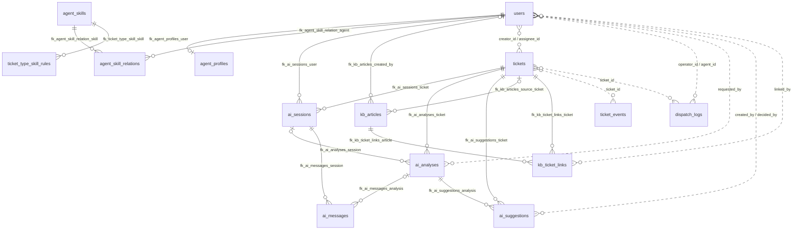

# ServiceFlow AI 数据库设计

> 依据：`deploy/init/*.sql`、`deploy/migrations/*.sql`、后端 repository 中的真实 SQL、`application*.yml`、根 `docker-compose.yml`。
> 本文只描述仓库中已存在的表/字段/索引；未在生产规模数据上验证的结论会明确标注。

## 1. 数据库与连接参数

| 项 | 实际值 |
| --- | --- |
| 数据库 | MySQL 8.4（`docker-compose.yml` 镜像 `mysql:8.4`） |
| 库名 | `serviceflow`（`MYSQL_DATABASE` 默认值） |
| 字符集 / 排序 | `utf8mb4` / `utf8mb4_unicode_ci`（库、全部业务表、容器 `--character-set-server` 与 `--collation-server` 一致） |
| 存储引擎 | InnoDB |
| 容器时区 | `TZ=Asia/Shanghai` |

`application.yml` 的真实 JDBC URL 参数如下（凭据全部来自环境变量）：

| 参数 | 作用与取舍 |
| --- | --- |
| `useUnicode=true&characterEncoding=utf8` | 客户端编码；表实际为 `utf8mb4`，可存中文与 emoji |
| `useSSL=false` | 本地/Compose 内网默认关闭 TLS；接外部数据库时应改为启用 TLS，并同步调整 URL |
| `allowPublicKeyRetrieval=true` | 非 TLS 下配合 MySQL 8 `caching_sha2_password` 获取公钥；仅适用于可信内网 |
| `serverTimezone=Asia/Shanghai` | JDBC 会话时区，与容器 `TZ`、业务 `LocalDateTime` 口径一致 |
| `connectTimeout=3000` | 建立连接 3 秒超时，快速失败 |
| `socketTimeout=5000` | 单次 socket 读 5 秒超时，避免请求线程被慢库长期占用 |

连接池（Hikari）：`maximum-pool-size=5`、`minimum-idle=1`、`connection-timeout=3000`、`validation-timeout=2000`、`initialization-fail-timeout=-1`。最后一个参数允许数据库暂不可用时仍启动进程，由 `/api/health/ready` 如实报告（MySQL 不可用返回 503）。

## 2. 全部真实表清单

初始化脚本与迁移脚本共创建 **14 张业务表**，另有 1 张迁移快照表 `tickets_phase2_backup`。

### 2.1 认证用户

| 表 | 用途 | 关键字段 | 主键 / 索引（SQL 中真实存在） |
| --- | --- | --- | --- |
| `users` | 登录账号、角色、启停状态 | `username`、`password`（BCrypt 哈希）、`name`、`role`（ADMIN/AGENT/USER）、`status`（1 正常 / 0 禁用）、`created_at`、`updated_at` | PK `id`；UNIQUE `username` |

### 2.2 工单与事件

| 表 | 用途 | 关键字段 | 主键 / 索引 |
| --- | --- | --- | --- |
| `tickets` | 工单主体，保存 SLA 截止与各终态时间 | `ticket_no`、`title`、`description`、`type`、`priority`、`status`、`creator/creator_id`、`assignee/assignee_id`、`sla_due_at`、`first_response_at`、`resolved_at`、`closed_at`、`cancelled_at`、`resolution`、`cancel_reason`、`created_at`、`updated_at` | PK `id`；UNIQUE `uk_tickets_ticket_no(ticket_no)`；`idx_tickets_status`、`idx_tickets_priority`、`idx_tickets_created_at`、`idx_tickets_sla_due_at`、`idx_tickets_assignee_id`；phase6 追加 `idx_tickets_assignee_created(assignee_id,created_at)`、`idx_tickets_status_resolved(status,resolved_at)` |
| `ticket_events` | 工单时间线与流转审计的唯一来源 | `ticket_id`、`action`、`from_status`、`to_status`、`operator_id/operator_name`、`note`、`created_at` | PK `id`；`idx_ticket_events_ticket(ticket_id,id)` |
| `tickets_phase2_backup` | phase3 迁移首次执行时的工单快照，供回退核对；应用不读写 | 与当时 `tickets` 同列 | SQL 未声明主键或索引 |

### 2.3 人员技能与调度

| 表 | 用途 | 关键字段 | 主键 / 索引 |
| --- | --- | --- | --- |
| `agent_profiles` | 人员档案，与用户 1:1 | `user_id`、`max_concurrent`、`availability`（AVAILABLE/BUSY/OFFLINE/DISABLED）、`created_at`、`updated_at` | PK `user_id`；`idx_agent_profiles_availability`；FK `fk_agent_profiles_user -> users(id) ON DELETE CASCADE` |
| `agent_skills` | 技能字典 | `skill_code`、`skill_name`、`description`、`created_at` | PK `id`；UNIQUE `uk_agent_skills_code(skill_code)`、`uk_agent_skills_name(skill_name)` |
| `agent_skill_relations` | 人员—技能关系与熟练度 | `agent_id`、`skill_id`、`proficiency_level`（1~4）、`created_at` | PK `id`；UNIQUE `uk_agent_skill_relation(agent_id,skill_id)`；`idx_agent_skill_relation_skill(skill_id)`；FK 到 `users`（CASCADE）与 `agent_skills` |
| `ticket_type_skill_rules` | 工单类型所需/加分技能规则 | `ticket_type`、`skill_id`、`required`（1 必需 / 0 加分） | PK `id`；UNIQUE `uk_ticket_type_skill(ticket_type,skill_id)`；`idx_ticket_type_skill_type(ticket_type)`；FK 到 `agent_skills` |
| `dispatch_logs` | 推荐与确认分配的快照日志 | `ticket_id`、`ticket_no`、`action`（RECOMMEND/ASSIGN）、`operator_id/name`、`agent_id/name`、`score`、`candidate_count`、`note`、`detail`（JSON 候选快照）、`created_at` | PK `id`；`idx_dispatch_logs_ticket(ticket_id,id)`、`idx_dispatch_logs_agent`、`idx_dispatch_logs_created`；phase6 追加 `idx_dispatch_logs_action_created(action,created_at)` |

### 2.4 AI 分析与建议

| 表 | 用途 | 关键字段 | 主键 / 索引 |
| --- | --- | --- | --- |
| `ai_sessions` | 与工单关联的 AI 会话 | `ticket_id`、`user_id`、`title`、`status`（ACTIVE/ARCHIVED）、`created_at`、`updated_at` | PK `id`；`idx_ai_sessions_user(user_id,updated_at)`、`idx_ai_sessions_ticket(ticket_id,id)`；FK 到 `users`、`tickets`（均 CASCADE） |
| `ai_analyses` | 每次 AI 调用的请求/结果记录 | `ticket_id`、`session_id`、`analysis_type`（TICKET_ANALYSIS/PRIORITY/SOLUTION/DISPATCH/CHAT）、`status`（PENDING/SUCCESS/FAILED）、`requested_by`、`prompt_version`、`model`、`latency_ms`、`ticket_snapshot`、`result_json`、`error_code`、`error_message`、`created_at`、`completed_at` | PK `id`；`idx_ai_analyses_ticket(ticket_id,id)`、`idx_ai_analyses_user(requested_by,id)`、`idx_ai_analyses_type(analysis_type,created_at)`；phase6 追加 `idx_ai_analyses_status_created(status,created_at)`；FK 到 `tickets`（CASCADE）、`ai_sessions`（SET NULL） |
| `ai_messages` | 会话内用户提问与 AI 回复 | `session_id`、`role`（USER/ASSISTANT/SYSTEM）、`content`、`analysis_id`、`created_at` | PK `id`；`idx_ai_messages_session(session_id,id)`；FK 到 `ai_sessions`（CASCADE）、`ai_analyses`（SET NULL） |
| `ai_suggestions` | 可被人工确认/拒绝/执行的 AI 建议 | `analysis_id`、`ticket_id`、`suggestion_type`（CLASSIFICATION/PRIORITY/SOLUTION）、`status`（PENDING/ACCEPTED/REJECTED/EXECUTED）、`payload`、`summary`、`created_by`、`decided_by`、`decided_at`、`decision_note`、`execution_note`、`created_at`、`updated_at` | PK `id`；UNIQUE `uk_ai_suggestion_analysis_type(analysis_id,suggestion_type)`；`idx_ai_suggestions_ticket(ticket_id,status)`；phase6 追加 `idx_ai_suggestions_status_created(status,created_at)`；FK 到 `ai_analyses`、`tickets`（均 CASCADE） |

### 2.5 知识库

| 表 | 用途 | 关键字段 | 主键 / 索引 |
| --- | --- | --- | --- |
| `kb_articles` | 知识文章；第一版为关键词 `LIKE` 检索，无向量库 | `title`、`category`、`problem`、`solution`、`tech_stack`、`keywords`、`source_ticket_id`、`status`（PUBLISHED/ARCHIVED）、`created_by`、`updated_by`、`created_at`、`updated_at` | PK `id`；UNIQUE `uk_kb_articles_title(title)`；`idx_kb_articles_category`、`idx_kb_articles_updated`；FK 到 `tickets`、`users`（均 SET NULL） |
| `kb_ticket_links` | 知识与工单的多对多关联 | `article_id`、`ticket_id`、`linked_by`、`note`、`created_at` | PK `id`；UNIQUE `uk_kb_ticket_link(article_id,ticket_id)`；`idx_kb_ticket_links_ticket(ticket_id)`；FK 到 `kb_articles`、`tickets`（均 CASCADE） |

## 3. 核心关系

实线为 SQL 中真实存在的物理外键（共 16 个）；虚线为**逻辑关联、无外键约束**的字段。



- 物理外键：`agent_profiles`、`agent_skill_relations`、`ticket_type_skill_rules`、`ai_sessions`、`ai_analyses`、`ai_messages`、`ai_suggestions`、`kb_articles`、`kb_ticket_links` 的关联列。
- 逻辑关联：`tickets.creator_id / assignee_id`、`ticket_events.ticket_id / operator_id`、`dispatch_logs.ticket_id / operator_id / agent_id`、`ai_analyses.requested_by`、`ai_suggestions.created_by / decided_by`、`kb_articles.updated_by`、`kb_ticket_links.linked_by`。这些列没有 FK，删除用户/工单不会由数据库联动。
- 删除语义：`tickets` 被删除时，`ai_sessions`、`ai_analyses`、`ai_suggestions`、`kb_ticket_links` 由 FK CASCADE 联动；`ticket_events` 无 FK，仓库提供 `TicketEventRepository.deleteByTicketId` 由应用层处理。
- 枚举值（`role/type/priority/status/action/...`）全部以 `VARCHAR` 存储，SQL 中没有 `ENUM` 或 `CHECK` 约束，合法性由 Java 枚举与校验保证。

## 4. 索引策略与第六阶段 EXPLAIN 结论

第六阶段只新增 5 个复合索引（`20261116-phase6-analytics-indexes.sql`，执行前检查 `information_schema.statistics`，可重复执行）：

| 索引 | 服务的查询 |
| --- | --- |
| `tickets(assignee_id, created_at)` | 人员 + 时间区间统计 |
| `tickets(status, resolved_at)` | 解决/关闭趋势 |
| `ai_analyses(status, created_at)` | AI 调用状态 + 区间聚合 |
| `ai_suggestions(status, created_at)` | 建议状态 + 区间统计 |
| `dispatch_logs(action, created_at)` | 推荐/分配动作 + 区间统计 |

`docs/phase6-test-report.md` 的真实 EXPLAIN 结论：

| 查询 | 结果 |
| --- | --- |
| 人员 + 区间 | `type=ref`，key=`idx_tickets_assignee_id`（rows=1），复合索引为候选 |
| 解决趋势 | `type=ref`，key=`idx_tickets_status`（rows=6），复合索引为候选 |
| AI 调用按状态 | `type=index`，key=`idx_ai_analyses_status_created`，`Using index`（覆盖索引） |
| AI 建议按状态 | `type=index`，key=`idx_ai_suggestions_status_created`，`Using index` |
| 调度动作 | `type=index`，key=`idx_dispatch_logs_action_created`，`Using index` |
| SLA 区间聚合 | `type=ALL`（rows=22） |

当时 `tickets` 仅 22 行，优化器对第 1、2、6 类查询选择单列索引或全表扫描已是最低成本；第 3~5 类命中覆盖索引。大数据量下的实际收益**未验证**。因此本文不新增任何索引。

## 5. 初始化与迁移策略

| 脚本 | 内容 | 重复执行 |
| --- | --- | --- |
| `deploy/init/01-init.sql` | 建库并显式设置 `utf8mb4/utf8mb4_unicode_ci` | 可（`CREATE DATABASE IF NOT EXISTS` + `ALTER DATABASE`） |
| `deploy/init/02-tickets.sql` | `tickets` 及 phase3 所需的全部列/索引 | 可（`CREATE TABLE IF NOT EXISTS`） |
| `deploy/init/03-users.sql` | `users` | 可（`IF NOT EXISTS`） |
| `deploy/init/04-ticket-events.sql` | `ticket_events` | 可（`IF NOT EXISTS`） |
| `deploy/init/05-agent-dispatch.sql` | phase4 人员/技能/规则/调度日志 + 技能与规则种子 | 从 SQL 看可重复：建表 `IF NOT EXISTS`、技能 `INSERT IGNORE`、规则 `INSERT ... SELECT ... WHERE NOT EXISTS` |
| `migrations/20261116-phase3-workflow.sql` | 旧库升级：备份表、幂等加列/索引、旧状态映射、SLA 与人员 id 回填、补 CREATE 事件 | 可（列/索引存在性判断；备份表只首次创建） |
| `migrations/20261116-phase4-agent-dispatch.sql` | 与 `init/05` 内容完全一致，用于旧库升级 | 同上；部署文档标注其含非幂等种子，要求旧库只执行一次（本文按该保守策略） |
| `migrations/20261116-phase5-ai-knowledge.sql` | AI 会话/分析/消息/建议、知识库表 + 6 篇知识种子 | 可（`IF NOT EXISTS` + `INSERT IGNORE`） |
| `migrations/20261116-phase6-analytics-indexes.sql` | 5 个统计复合索引 | 可（`information_schema.statistics` 存在性判断） |

执行顺序：

- **全新库**：`deploy/init/01~05` 按文件名顺序执行，覆盖 phase1~4；再由 Compose 的 `migrate` 一次性执行 phase5、phase6。
- **旧库升级**：先 phase3，再 phase4，最后 phase5、phase6。`phase4` 在部署文档中标注为“含非幂等种子、只执行一次”；按此保守策略，不要让旧库重复执行 phase4。
- 根 `docker-compose.yml` 中 `migrate` 只执行 phase5/phase6，因为新库的 phase1~4 已由 init 完成，避免重复插入 phase4 种子。
- MySQL 的 `docker-entrypoint-initdb.d` 只在**空数据卷**首次启动时执行；已有 `mysql-data` 卷不会重跑 init。

## 6. 数据一致性与并发

- **状态流转事务**：`TicketWorkflowService` 的 `assign/transfer/accept/start/resolve/close/cancel` 均标注 `@Transactional`；先由 `TicketWorkflowEngine` 校验动作与权限，再用 `UPDATE ... WHERE id = ? AND status = 期望旧值` 条件更新，影响行数为 0 时抛 `ConflictException`（HTTP 409），并写入 `ticket_events`。状态与事件在同一事务内提交。
- **调度分配并发**：`DispatchService.assign` 重新执行候选过滤后才调用工作流分配；工单已被他人流转时由上述条件更新返回 409，避免重复分配。人员 `max_concurrent` 是“事务内读取后判断”，数据库没有配额约束或行锁，极端并发下同一人员可能被短暂分配到超过上限。
- **AI 建议并发**：`ai_suggestions` 的采纳/拒绝使用 `UPDATE ... WHERE id = ? AND status = 'PENDING'` 原子占用，返回 0 表示已被处理；执行成功才置 `EXECUTED`，失败可回退 `PENDING`。AI 不直接写工单，Java 在人工确认后才调用工作流。
- **AI 分析状态**：先插入 `PENDING`，再按调用结果 `markSuccess` / `markFailed` 并写 `completed_at`；失败保留 `error_code/error_message`。
- **时间字段口径**：业务时间列均为 `DATETIME`（不带时区），Java 使用 `LocalDateTime.now()` 写入；`created_at/updated_at` 有数据库默认值，`updated_at` 带 `ON UPDATE CURRENT_TIMESTAMP`。容器 `TZ`、JDBC `serverTimezone` 统一为 `Asia/Shanghai`。`first_response_at` 仅在首次 ACCEPT 写入；`resolved_at/closed_at/cancelled_at` 只在对应动作写入；分析类 SQL 用 `COALESCE(resolved_at, closed_at)` 作为完成时间。
- **SLA 口径**：创建时按优先级写入 `sla_due_at`（默认 4/8/24/72 小时，可由环境变量调整）；phase3 迁移的回填规则与 Java 默认值一致。

## 7. 备份与恢复

在仓库根目录执行（服务名与根 `docker-compose.yml` 一致）：

```bash
# 备份 serviceflow 库到宿主机 backup.sql
docker compose exec mysql sh -c 'mysqldump -u root -p"$MYSQL_ROOT_PASSWORD" serviceflow' > backup.sql

# 从 backup.sql 恢复（会覆盖目标库同名表数据，先确认目标与环境）
docker compose exec -T mysql sh -c 'mysql -u root -p"$MYSQL_ROOT_PASSWORD" serviceflow' < backup.sql
```

数据文件在命名卷 `mysql-data`：`docker compose down` 保留数据，`docker compose down -v` 会删除卷并清空数据库，生产环境禁止随意执行。
